# Analysis of Dust, SOMA, and State of ZO Research

<br>


<br>

Since I wrote [Scaling Agents to Unfathomable Depth and Context With Zeroth-Order Optimization](Scaling_To_Unfathomable_Depth.html), there have been multiple good Zeroth Order Optimization papers, particularly for pretraining. People have been asking for my take on them. So here I am, writing an article. But I got a bit carried away.

### How to Read This Article

This is article going to appear really dense. That's fair, it's kinda a massive brain dump. Some parts are dense and complicated, but be not afraid, for the rest of the article is written to be very accessible.

If you want to understand the algorithms, I have summarized them here in pseudocode and a table of terminology. You can skip past them though. In the math section, there is going to be a lot of math. But it's written so you don't have to read the stuff that's outside of code blocks.

I sincerely recommend skimming. Then if you're curious you can dig deeper, and use AI assistance to answer questions. Or just DM me [@apaz_cli](https://x.com/apaz_cli), that works too.

## SOMA

The first standout paper is [SOMA](https://arxiv.org/abs/2609.37899), by a team out of Stanford. Here's the method:

::: {.algo}

```python
def soma_step(θ_e, b):                       # one update of one expert
    grad_est = zeros(p // N)
    for j in range(Z):
        z = sparse_rademacher(p // N)
        proj_grad = (L(Φ(θ_e + ε * z, b), E) - L(Φ(θ_e - ε * z, b), E)) / (2 * ε)
        grad_est += proj_grad * z
    grad_est /= Z
    return adam_step(θ_e, grad_est, α)


def soma_train(data):
    θ_seed, E = pretrain_briefly(data)       # one model (N = 1); E is then frozen
    D, centroids = kmeans(tfidf(data), N)    # split data into N clusters
    θ = [copy(θ_seed) for e in range(N)]
    for e in range(N):                       # In parallel, on different machines
        for b in batches(D[e], B):
            θ[e] = soma_step(θ[e], b)
    return θ, E, centroids


def soma_predict(θ, E, centroids, context):
    S = nearest(centroids, tfidf(context), k)
    return mean([softmax(Φ(θ[e], context) @ E.T) for e in S])
```

| Term | Meaning | Type / Shape |
|---|---|---|
| `N` | number of experts = number of data clusters | int |
| `p` | total parameters across all experts | int |
| `θ[e]` | weights of expert `e` (small LSTM), flattened | float `[p/N]` |
| `θ_seed` | weights of a briefly pretrained single model | float `[p/N]` |
| `Φ` | model architecture; returns hidden states | function → `[B, T, d_E]` |
| `E` | shared token embedding/decoder, frozen | float `[V, d_E]` |
| `V`, `d_E` | vocab size, embedding width | int |
| `L` | next-token cross-entropy, decoding through `E` | function → float scalar |
| `data` | training data | dataset of token sequences |
| `D[e]` | data cluster `e` | dataset of token sequences |
| `centroids` | k-means centroids of the clusters, in tf-idf feature space | float `[N, d_tfidf]` |
| `B`, `T` | sequences per batch, tokens per sequence | int |
| `b` | batch from `D[e]` | int tensor `[B, T]` |
| `batches(D, B)` | iterates over `D` in batches of `B` sequences | generator of `[B, T]` |
| `θ_e` | weights of the one expert being updated | float `[p/N]` |
| `z` | random direction; each entry 0 w.p. ½, else ±1 | float `[p/N]` |
| `ε` | perturbation scale | float |
| `Z` | number of directions per step | int |
| `proj_grad` | central finite difference along `z` | float scalar |
| `grad_est` | estimated gradient for `θ[e]` | float `[p/N]` |
| `α` | learning rate | float |
| `context` | prompt at inference | int tensor `[T]` |
| `k` | experts used at inference | int |
| `S` | indices of the `k` experts whose cluster centroids are nearest to `context` | list of int |

:::

<br>

The name of the paper is "Scaling Zero-Order Pretraining Through Model Sharding." That is true, we are doing that. But fundamentally, what we're doing is actually ensembling. We are not capable of pretraining good models with ZO. What if we pretrain a bunch of bad ones, and then ensemble? Then perhaps we can get a lot further.

I am not sure how to feel about this paper. On one hand, it seems obvious. Obviously you can get gains by ensembling. It's not something I would even think to publish. But on the other hand, nobody has pointed out before that Branch-Train-Merge clearly has applications in ZO. It didn't occur to me that this was a reasonable scaling axis.

If the noise issue in ZO pretraining truly cannot be beaten, then this and model merging are clearly the best strategy, and nobody is doing it. It doesn't solve any of the fundamental problems in ZO, and obviously it cannot scale past a certain size or training budget, but I'm glad we now have a good example of people doing this.

I think there's a good chance this ends up being really useful. With that being said, because of the Dust paper I think we actually CAN beat the noise issue. Then maybe this is a cherry on top.

I don't have a lot more to say about it other than that. Good paper on net.

## Dust

The next is [Dust](https://qlabs.sh/research/dust), out of qlabs. The method:

::: {.algo}

```python
def dust_step(θ, b):
    ℓ, X = forward(Φ, θ, b)                            # save each layer's input X[W]
    for W in linear_layers(θ):
        grad_Y = zeros(T, d_out)
        for j in range(Z):
            z = randn(T, d_out)
            ℓ_j = forward(Φ, θ, b, noise={W: ε * z})   # adds ε*z to Y, W's output
            proj_grad = (ℓ_j - ℓ) / ε
            grad_Y += proj_grad[:, None] * z
        grad_Y /= Z
        grad_est = grad_Y.T @ X[W]
        W -= α * grad_est
    return θ


def dust_train(θ, data):
    for b in batches(data, T):
        θ = dust_step(θ, b)
    return θ
```

| Term | Meaning | Type / Shape |
|---|---|---|
| `θ` | all model weights | list of tensors |
| `Φ` | model architecture | function |
| `data` | training data | dataset of token ids |
| `batches(data, T)` | iterates over `data` in batches of `T` tokens | generator of `[T]` |
| `b` | input batch | int tensor `[T]` (token ids) |
| `T` | number of tokens in `b` | int |
| `L` | loss; returns one loss per token | function → `[T]` |
| `ℓ` | clean per-token loss, `L(Φ(θ, b))` | float `[T]` |
| `W` | weights of one linear layer | float `[d_out, d_in]` |
| `d_in`, `d_out` | that layer's input / output width | int |
| `X[W]` | input to layer `W` in the clean pass | float `[T, d_in]` |
| `Y` | output of layer `W` in the clean pass, `X[W] @ W.T` | float `[T, d_out]` |
| `z` | gaussian noise added to `Y`, independent per token | float `[T, d_out]` |
| `ε` | perturbation scale | float |
| `Z` | number of draws per layer | int |
| `ℓ_j` | per-token loss with noise added | float `[T]` |
| `proj_grad` | per-token finite difference | float `[T]` |
| `grad_Y` | estimate of ∂L/∂Y | float `[T, d_out]` |
| `grad_est` | estimated gradient for `W` | float `[d_out, d_in]` |
| `α` | learning rate | float |

:::

Dust seems like a massive step forward. It shows that many of the supposed issues with ZO for pretraining were in fact skill issues. This is great.

The upshot of the method is that we need to find more efficient ways to sample more perturbations, sharded across more axes. SOMA sort of does this, you can do DP and ensemble or merge.

But Dust attempts to tackle the main issue. What you really want is more perturbations sampled inside the model. The primary difference between Dust and previous methods is that each token gets a separate perturbation, and each layer gets a separate perturbation. This leads to a huge uplift in practical performance, for the same amount of data.

It is unfortunate, though, that this research direction kind of flies in the face of the reason I was excited about ZO in the first place. To train a [recurrence-complete](https://arxiv.org/abs/2510.06828) architecture without backprop through time. This method only works on transformers and other architectures with a parallelizable forward pass, in settings with loss functions that can be parallelized.


Specifically, to perturb by token you need the per-token losses ℓ, which does not exist if you're doing something like replacing RL. Because "how well was this task completed" not have a loss with per-token credit assignment. And per-token losses are not clean if you do something like roll out an RNN, because of the state dependence. And even if it might work on an RNN, it's expensive.

### Virtual population

Still, the observation that each token and each layer is a place where you can effectively split to sample more perturbations is novel. Or, it makes a tremendous amount of sense in hindsight, but nobody thought of it until now. Let's make sense of it.

First, recall that training transformers is parallelizable. There are efficiency benefits for running everything at once, but efficiency is the only reason we batch. The forward pass for one token does not depend on the forward pass of the previous. The standard crossentropy objective just averages all those individual token losses. We know how much of the loss is that token's fault, and so if we perturb activations we can know how much of a change in loss is that token's fault.

Side tangent, that is not quite what Dust computes. Cross-entropy credits each token for its effect on every later token's loss. Dust only credits it for its own, so it never trains activations to be helpful for predicting later tokens. Except for the keys, values, gates, and value embeddings, which the Dust paper does not approximate for.

So, Dust doesn't follow the gradient of the loss we're actually training on. It's a biased estimator, which is to say an approximation. At small scales it appears to be a very good approximation. I measure the effect in some experiments later in the article.

Next, returning to the population size argument, recall from the last article the gradient variance formula for SPSA:

```
Var(grad_est) = ∇L(Φ(θ))² / Z
              + ∇L(Φ(θ,xᵢ))² / ZB
```

Where the first term is the noise from sampling perturbations, and the second is the noise from sampling batches of data. We want to make the sum of these two numbers go down. That is the most important thing for the scalability of ZO pretraining, or ZO training in general.

Scaling batch size B and perturbation sample count Z each reduce the variance. But you have the choice between scaling Z or B. Which do you scale? You scale Z, because it divides both terms, especially the first one, which becomes the dominant source of variance as you increase the parameter count. And we desperately want to increase the parameter count.

The virtual population method effectively takes you from the
```
B = seq_len
Z = n_pert

of SPSA on one sequence to

B = 1
Z = n_pert * seq_len

in Dust, because every token gets its own individual z.
```

This is good. Big. Huge. It makes the SNR less terrible, and implies that ZO may be a great way to train on really really long sequences.

Of course, the math is not that simple. I said "effectively." The actual SNR also depends on other things. Let's get into that.

### Dust Math

Let's redo the "MeZO Math" section from the last article, but for Dust's estimator. Like last article, you can skim by reading only the parts outside code blocks.

Dust's update is a gradient estimate, so we ask the usual questions. Is it unbiased? How noisy is it compared to what it's estimating? What SNR does that give? Then we'll compare it to MeZO and SPSA.

#### Bias and Signal

Consider a single linear layer `W`, with input `X` and output `Y`. Dust adds gaussian noise to `Y`, drawn separately for every token. For each token `t`, the update rule is:

```
proj_gradₜ = (Lₜ(Φ(θ, b; Y + εz)) - Lₜ(Φ(θ, b))) / ε
grad_Yₜ    = proj_gradₜ * zₜ

For some per-token loss function L, where Lₜ is the loss at token t,
some model architecture Φ,
the current model weights θ,
a batch of inputs b, containing T tokens,
the output Y of layer W, where Yₜ is token t's row, of width d_out,
the forward pass Φ(θ, b; Y + εz), which adds εz to Y and runs the rest of the model,
a gaussian distribution z ~ N(0,I) of the same shape as Y (sampled every draw), where zₜ is token t's row,
and a scalar hparam ε.
```

For readability, let's say `∇ₛLₜ` is the gradient of token `t`'s loss with respect to `Yₛ`, token `s`'s row of the layer output.

Recall that token `t`'s loss can depend on `Yₛ` for any `s ≤ t`, because attention in the later layers reads from earlier tokens. It can't depend on `s > t`, because of the causal mask.

<br>
<div style="text-align: center;">
<figure>
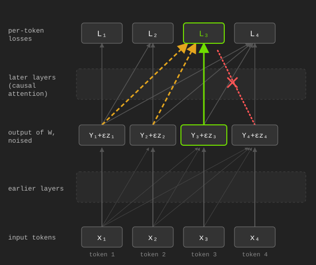
<figcaption aria-hidden="true">Earlier tokens' noise leaks in through attention.</figcaption>
</figure>
</div>
<br>

We want to know two things about `grad_Yₜ`. We want to know if it follows the true gradient (the signal, so to speak), and how noisy our gradient estimate is. That is to say, what is its variance? This allows us to derive the signal to noise ratio, or SNR.

First, is it unbiased? Let's apply a [generalized](https://en.wikipedia.org/wiki/Zero_bias_transform) version of [Stein's Lemma](https://en.wikipedia.org/wiki/Stein%27s_lemma). Apply it with `f(z) = Lₜ(Φ(θ, b; Y + εz))`:

```
E[grad_Yₜ] = E[proj_gradₜ * zₜ]                                       (definition of grad_Yₜ)
           = E[(Lₜ(Φ(θ, b; Y + εz)) - Lₜ(Φ(θ, b))) * zₜ] / ε          (definition of proj_gradₜ)
           = E[Lₜ(Φ(θ, b; Y + εz)) * zₜ] / ε - Lₜ(Φ(θ, b)) * E[zₜ] / ε (distribute)
           = E[ε * ∇ₜLₜ(Φ(θ, b; Y + εz))] / ε                         (Cancel and apply chain rule, zₜ moves Yₜ by ε)
           = E[∇ₜLₜ(Φ(θ, b; Y + εz))]                                 (Stein's Lemma, taking ∇ with respect to zₜ)
```

So, yes. The math works out. For each next token, the rule obtains that token's gradient. You can then average them and take a step.

But Dust is in fact a biased estimator. It calculates `∇ₜLₜ`, which is how token `t`'s activations affect token `t`'s loss. But these activations also affect every later token's loss, through attention. The true gradient is:

```
∇ₜL = ∇ₜLₜ + Σᵤ>ₜ ∇ₜLᵤ
```

That is a different thing than a reduction of the individual `∇ₜLₜ` per-token gradients. But how much does this matter? It's unclear. It doesn't seem to matter that much when it comes to just reducing language modeling loss. But in the limit it might matter, it's sort of an open question. 

#### Variance

There is no Stein's Lemma for variance. But there's a trick. Split the reward into the best linear function of the noise, plus whatever is left over. By Stein's Lemma again (yay!), the best linear fit is `Σₛ ∇ₛLₜ · zₛ`, for every token `s ≤ t`. Then there is some uncorrelated extra part which is nonlinear, we'll call this remainder term `rₜ`.

```
proj_gradₜ = Σₛ<ₜ ∇ₛLₜ · zₛ + rₜ                     (summing over s ≤ t)

E[proj_gradₜ²] = E[(Σₛ ∇ₛLₜ · zₛ)²] + E[rₜ²]
               = Σₛ ||∇ₛLₜ||² + E[rₜ²]
               = ||∇ₜLₜ||² + Σₛ<ₜ ||∇ₛLₜ||² + E[rₜ²]
               = ||∇ₜLₜ||² * (1 + Σₛ<ₜ ||∇ₛLₜ||² / ||∇ₜLₜ||² + E[rₜ²] / ||∇ₜLₜ||²)
               = ||∇ₜLₜ||² * (1 + κₜ + ηₜ)

where κₜ = Σₛ<ₜ ||∇ₛLₜ||² / ||∇ₜLₜ||²
      ηₜ = E[rₜ²] / ||∇ₜLₜ||²
```

The first part `||∇ₜLₜ||²` is the irreducible variance which comes from sampling in a direction, for one token.

The second part `κₜ` is the noise we added at tokens earlier than `t`, leaking into token `t`'s loss through attention. We'll call it "leakage."

The third, `ηₜ`, is everything in the reward that isn't linear in the noise. If the loss were a straight line across the noise, it would be zero. The bigger `ε` is, the more the loss curves over the step, and the bigger it gets. Using Rademacher perturbations would minimize this, because it's the distribution with the minimum possible fourth moment, but expect the effect to be small.

So, the the variance is MeZO's, times a `(1 + κₜ + ηₜ)` penalty. `κₜ` is up to the model, `ηₜ` grows with `ε`, which is a hyperparameter we can tune.

`κₜ` (kappa) and `ηₜ` (eta) are ratios. The paper calls the leakage "interference," so I'll call `κₜ` the interference ratio, and `ηₜ` the curvature ratio.

#### Signal-to-Noise Ratio of Dust

Now the SNR, for one perturbation of one token. Recall that the signal is `||E[grad_Yₜ]||² = ||∇ₜLₜ||²`. Now for the noise.

```
grad_Yₜ = proj_gradₜ * zₜ
so
E[||grad_Yₜ||²] = E[proj_gradₜ² * ||zₜ||²]
                ≈ E[proj_gradₜ²] * d_out                    (||zₜ||² is about d_out, and exactly d_out for Rademacher)
                = ||∇ₜLₜ||² * (1 + κₜ + ηₜ) * d_out
```

Therefore, we can define the tokenwise-layerwise SNR as follows.

```
SNR ≈ ||E[grad_Yₜ]||² / E[||grad_Yₜ||²]
    = 1 / (d_out * (1 + κₜ + ηₜ))
```

Since each token `t` of `T` tokens is independent, and each draw of `Z` total draws of every layer is independent, it is easy to derive the SNR of the full Dust update.

```
SNR ≈ ZT / (d_out (1 + κ + η))
```

This is for a cost of `Z * n_layers` many partial forward passes, with a cost on average of half a full forward pass, as some will be longer and some shorter. As opposed to the `2 * Z` full forward passes of SPSA.

#### Dust's expected alignment versus the true gradient

Dust's estimator is biased. Here's the bias, and here's what the paper does about it.

Dust's per-token estimator targets `∇ₜLₜ`, how token `t`'s activations affect token `t`'s own loss. But those activations also change the loss of every token that comes later, through attention. The true gradient is the full causal sum:

```
∇ₜL = ∇ₜLₜ + Σᵤ>ₜ ∇ₜLᵤ
```

Dust drops everything after the first term. For most parameters this is a small bias, which is why Dust works. But for the attention keys and values, the gates and value embeddings, the dropped terms are the signal.

The paper fixes it by crediting token `t`'s jitter with a decaying share of every later token's loss. Token `u` counts for `γ^(u-t)` of its loss, for some discount `γ` between 0 and 1:

```
L̃ₜ = Lₜ + γ·Lₜ₊₁ + γ²·Lₜ₊₂ + γ³·Lₜ₊₃ + ...
    = Σᵤ≥ₜ γ^(u-t) Lᵤ
```

The paper writes this as a reward, `rₜ = Σᵤ≥ₜ γ^(u-t) cᵤ`, built from centered loss reductions `cᵤ`. Same object, opposite sign. I'll keep losses.

`L̃ₜ` is token `t`'s loss plus a decaying share of every later token's loss. The γ-estimator is Dust's rule with `L̃ₜ` in place of `Lₜ`:

```
proj_gradₜ = (L̃ₜ(Φ(θ, b; Y + εz)) - L̃ₜ(Φ(θ, b))) / ε
grad_Yₜ    = proj_gradₜ * zₜ
```

Stein's Lemma again, applied to `L̃ₜ`:

```
E[grad_Yₜ] = ∇ₜL̃ₜ
           = ∇ₜLₜ + γ·∇ₜLₜ₊₁ + γ²·∇ₜLₜ₊₂ + ...
           = Σᵤ≥ₜ γ^(u-t) ∇ₜLᵤ
```

So `γ` interpolates. At `γ = 0`, plain Dust: `E[grad_Yₜ] = ∇ₜLₜ`, and the entire future `Σᵤ>ₜ ∇ₜLᵤ` is dropped. At `γ = 1`, the discount vanishes and `E[grad_Yₜ] = ∇ₜL`, the true gradient. In between, the estimator blends them geometrically, older losses decaying as `γ^(u-t)`.

The bias is the gap between the two:

```
biasₜ = E[grad_Yₜ] - ∇ₜL
      = Σᵤ>ₜ (γ^(u-t) - 1) · ∇ₜLᵤ
```

zero at `γ = 1`, and `-Σᵤ>ₜ ∇ₜLᵤ` at `γ = 0`. Alignment with the true gradient, measured as cosine similarity, is therefore 1 at `γ = 1` and less than 1 at `γ = 0`. That is the quantity I measure as 0.99 later in this article.

Now the price. Scoring `zₜ` against later tokens' losses means later tokens' noise now lands in the estimate. Repeating the variance decomposition from before, the linear part of the reward gains one term per later loss:

```
proj_gradₜ = Σₛ zₛ · (Σᵤ≥max(t,s) γ^(u-t) ∇ₛLᵤ) + r̃ₜ
```

For `s = t` the coefficient is `Σᵤ≥ₜ γ^(u-t) ∇ₜLᵤ = E[grad_Yₜ]`, the signal itself. For `s < t` it is the leakage from earlier tokens, now spilled into every discounted later loss. So

```
E[proj_gradₜ²] = ||E[grad_Yₜ]||² + Σₛ<ₜ ||Σᵤ≥ₜ γ^(u-t) ∇ₛLᵤ||² + E[r̃ₜ²]
```

and the SNR keeps the same shape as before,

```
SNR ≈ 1 / (d_out · (1 + κ̃ₜ + η̃ₜ))

κ̃ₜ = Σₛ<ₜ ||Σᵤ≥ₜ γ^(u-t) ∇ₛLᵤ||² / ||E[grad_Yₜ]||²
η̃ₜ = E[r̃ₜ²] / ||E[grad_Yₜ]||²
```

with the only change being that `κ̃` and `η̃` now also include the later-token terms, discounted by `γ`.

So `γ` trades bias against noise. Too small, and the estimator is biased: it never learns to be useful for later tokens. Too large, and the later tokens' noise swamps the signal. The paper tunes `γ` rather than deriving it: near one for the keys, values, gates, and value embeddings (0.98 to 0.99 in its runs), and zero everywhere else.

The discount is not there for aesthetics. A token's influence on distant future tokens tends to be weak and diffuse, so a geometric cutoff is a cheap prior. And it is applied only where the bias matters. Everywhere else it would buy back a sliver of bias for a lot of noise.

#### Comparison to MeZO/SPSA/ES/EGGROLL

Previous methods have all had a SNR on the order of `1/p`. For each batch, not each token. Where `p` stands for the parameter count. But in Dust, the `p` becomes `d_out`, the width of one layer's output. Which is a lot smaller.

So, let's compare. We'll say `T = 16,384` tokens, which is the Dust paper's batch size.

| Model | `p` (params) | `d_out` (hidden size) | `p / d_out` | flops per forward | SNR per FLOP (vs SPSA) |
|---|---|---|---|---|---|
| Dust's model (8 layers) | 37.75M | 512 | ~73,700× | ~1.12 TFLOPs | ~549M× |
| Qwen3.5-9B (32 layers) | 9.20B | 4096 | ~2.25M× | ~280 TFLOPs | ~4.18B× |
| Qwen3.5-27B (64 layers) | 27.32B | 5120 | ~5.34M× | ~899 TFLOPs | ~4.97B× |

So, it goes without saying, this is very lucrative. Yes, with Dust you have to apply this rule for each independent layer. But even if it cost 100x the computation, it would still be worth it. Then as you scale the model, it becomes even more worth it. The proof of this is that Dust drastically overperforms versus other methods on pretraining tasks where gradient alignment is important.

To summarize,
```
SNR(SPSA) ≈ Z / p
SNR(Dust) ≈ ZT / (d_out * (1 + κ + η))
SNR(Dust) / SNR(SPSA) per FLOP ≈ 4 * T * p / (n_layers * d_out * (1 + κ + η))
```

The factor of four is because Dust requires `n_layers` partial forwards at about half a full forward each, while SPSA requires two full forwards per draw.

Overall, a massive improvement.

#### How big are `κ` and `η` in practice?

This works great, as long as `κ` is small. That is to say, as long as noise added at tokens other than `t` don't affect the loss of token `t` very much. `η` also needs to be small.

So I trained small transformers on [TinyStories](https://huggingface.co/datasets/roneneldan/TinyStories) with the Dust repo, at three sizes, and compared it against backprop.

The models are 2 layers of width 128, 4 of width 256, and 8 of width 512, which is the paper's shape. Every 25 or 50 steps I measured `κₜ`, and at saved checkpoints I measured `ηₜ`. The former is obtained by backpropagating each token's loss and isolating the contribution of previous tokens, and the latter by sampling perturbations as Dust does, and comparing the reward variance measured to first order predictions, in high precision. The code is [here](TODO).

Let's look first at `κ`.

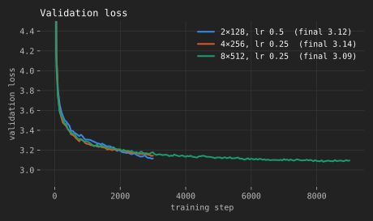

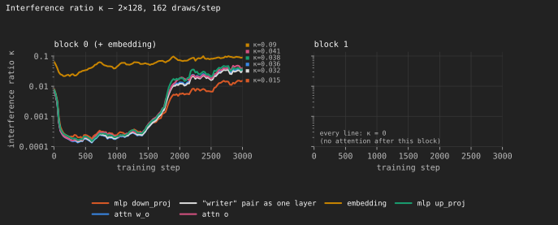

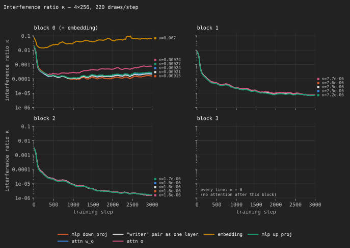

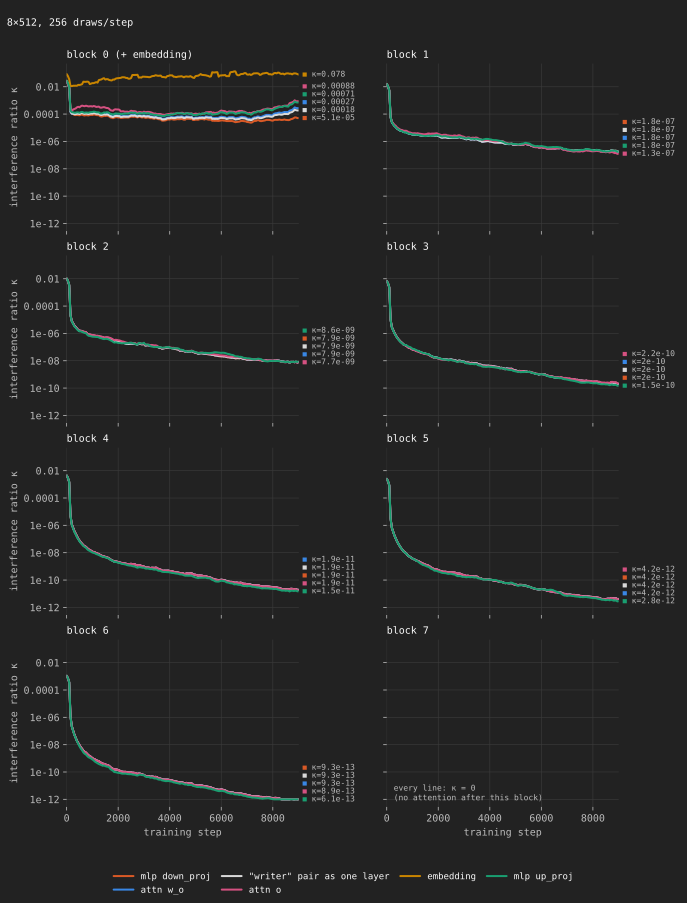

You can see a few things.

1. Overall, leakage is pretty low.
2. It's largest at blocks that are earlier in the model.
3. It gets smaller throughout training, although less for the first block.

The story here looks pretty good. Way better than I expected it to look, actually. Jitter to previous tokens does not affect the loss of following tokens that much through writes to kvcache.

Now, let's look at `η`. Things are weird because the effect is so small, and we're sampling, and there are numerical precision issues. But let's try to measure it anyway. When rounding noise would dominate and make it blow up, I just omit the data.

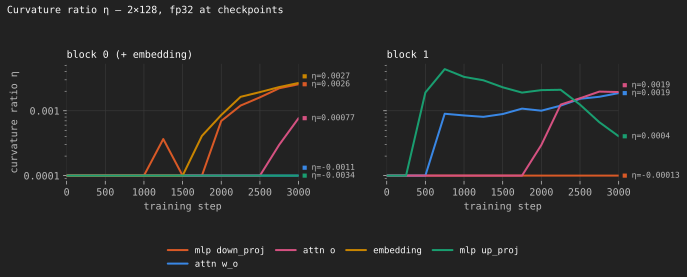

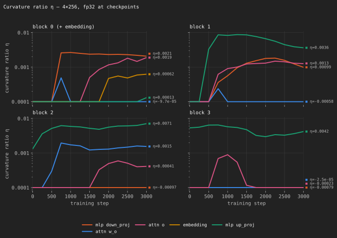

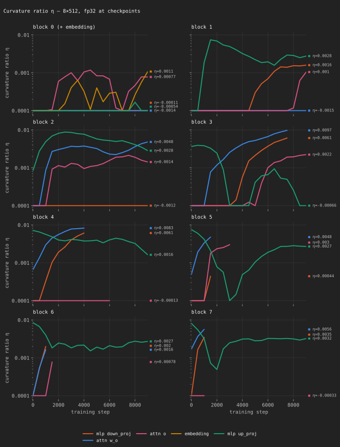

Basically, it's not bad. It's on the order of being negligible. Which is where we want it to be. Nice.

#### The bias is not leakage

The bias I've been describing is not the leakage we just measured. Leakage is noise, and it averages out over draws. The bias does not. It's because `zₜ` is only scored against `Lₜ`, so even with no noise anywhere, the future `Σᵤ>ₜ ∇ₜLᵤ` never shows up. The paper fixes this by giving token `t` a discounted share of the later tokens' losses, with decay `γ`. That removes the bias, but adds the later tokens' noise. In my runs the bias was small: by the end of training, the weight gradient Dust aims for had a cosine similarity of 0.99 with the true gradient.

##### `ε` is not small

The activations come out of an RMSNorm, so each coordinate is about unit size, and Dust uses `ε = 0.2` or `0.4`. That's 20-40% noise. A bigger `ε` costs variance through `η`, and an `O(ε²)` smoothing bias, the same as ES. A smaller `ε` costs precision, because the bf16 rounding error in the loss difference gets divided by `ε`. The repo's deeper layers use `ε = 0.4`, because 0.2 "moves the loss too little ... for a readable reward." So `ε` has to be tuned, like ES's `σ`.

##### The noise doesn't have to be gaussian

All of this works for any noise with zero mean, unit variance, a symmetric distribution, and independent coordinates. Rademacher noise (every coordinate is ±1) works too, and is slightly less noisy, because every `zᵢ²` is exactly 1. The one rule you can't break is independence across tokens. Without it, the `T` estimates are correlated and the virtual population is gone.

### Parameters or Activations?

## Noise

Over at qlabs they also recently launched a speedrun, which they call [noise](https://qlabs.sh/noise). Not technically a paper, but I have a take on this too.

### PR #11

The current record on its first track is [PR 11, "Boost → Cut"](https://github.com/qlabs-eng/noise/pull/11). It's interesting, so I think it's worth talking about. The method:

::: {.algo}

```python
def exact_grad(f, s):                                # forward differences along all d directions
    return sum((f(s + ε * D[j]) - f(s)) / ε * D[j] for j in range(d)) / d


def boost_step(θ, b, y):
    X, Y, S = forward(Φ, θ, b)                       # save each layer's input, output, and each stream
    for i in streams(θ):
        for t in range(T):
            f = lambda s: L_head(s, y[t])            # forward to the head, right after stream i
            grad_S[i][t] = exact_grad(f, S[i][t])
    return update(θ, X, Y, grad_S)


def cut_step(θ, b, y):
    X, Y, S = forward(Φ, θ, b)
    for i in streams(θ):
        for t in range(T):
            f = lambda s: L(Φ_cut(θ, i, s, t), y[t]) # forward through the rest, attention held clean
            grad_S[i][t] = exact_grad(f, S[i][t])
    return update(θ, X, Y, grad_S)


def update(θ, X, Y, grad_S):
    for W in layers(θ):
        if W in writers(θ):                          # its output is added to the stream
            grad_Y = grad_S[W]
        else:                                        # score its effect on the stream instead
            grad_Y = [exact_grad(lambda o: grad_S[W][t] @ effect(W, o, t), Y[W][t])
                      for t in range(T)]
        W -= α * grad_Y.T @ X[W]
    return θ


def boost_cut_train(θ, data):
    for n, (b, y) in enumerate(batches(data, T)):
        θ = boost_step(θ, b, y) if n < n_boost else cut_step(θ, b, y)
    return θ
```

| Term | Meaning | Type / Shape |
|---|---|---|
| `θ` | all model weights | list of tensors |
| `Φ` | model architecture | function |
| `data` | training data | dataset of token ids |
| `batches(data, T)` | iterates over `data` in batches of `T` tokens | generator of (`[T]`, `[T]`) |
| `b`, `y` | input tokens, and the next token at each position | int tensor `[T]` |
| `T` | number of tokens in `b` | int |
| `X[W]`, `Y[W]` | input and output of layer `W` in the clean pass | float `[T, d_in]`, `[T, d_out]` |
| `streams(θ)` | the residual stream after each attention and each MLP, and the embedding | list |
| `S[i]` | stream `i` in the clean pass | float `[T, d]` |
| `d` | residual stream width | int |
| `D` | ±1 Hadamard matrix; row `j` is a direction | float `[d, d]` |
| `ε` | step size of each forward difference | float |
| `exact_grad(f, s)` | gradient of `f` at `s`. Exact, not estimated, because `Dᵀ D = d * I` | float `[d]` |
| `L_head(s, y)` | loss of the shared head (final norm + LM head) reading stream `s` | function → scalar |
| `L(s, y)` | loss of the model's output stream `s` | function → scalar |
| `Φ_cut(θ, i, s, t)` | runs token `t`'s stream `s` from stream `i` to the output, with every attention output held clean | function → float `[d]` |
| `grad_S[i]` | measured gradient at stream `i`, one row per token | float `[T, d]` |
| `writers(θ)` | the layers whose output is added to a stream: each block's `attn w_o` and `mlp down_proj` | list of layers |
| `grad_S[W]` | `grad_S` at the stream `W` writes into, or feeds | float `[T, d]` |
| `effect(W, o, t)` | change in token `t`'s stream when `W`'s output is `o` instead of clean | function → float `[d]` |
| `grad_Y` | gradient at `W`'s output | float `[T, d_out]` |
| `n_boost` | number of Boost steps before switching to Cut | int |
| `α` | learning rate | float |

:::

The author on twitter cites [Neural Networks Are Already Clean](https://already-clean.goodfire.com/) as the source of inspiration. This confuses me greatly, because I feel like it has nothing or close to nothing do with the math.

To me, this is clearly [Forward Gradients With Local Losses](https://arxiv.org/abs/2210.03310), but with a full Hadamard basis instead of random directions, and using a shared logit lens head as the local loss.

I feel like there is no possible way that this can scale. Using a logit lens means that the training signal received is incredibly myopic. It makes sense that you can do well on a speedrun this way, but that's because it's a weak baseline which can be beaten quickly, before the incredibly biased gradient preventing updates across layers and blocks becomes an issue. To me, this is not a super promising direction.

Then again, it's always worth examining the world where you're wrong. It is also perhaps the case that most of what an LLM does is pass the same principal components through until it's time to predict the next token, and so not a lot of depth is effective depth. But this just absolutely murders any chance at credit across effective depth. How much does this matter? I suppose time will tell.

## Async ZO

It's worth mentioning that what was suspected is true, and that the optimal infrastructure for ZO looks a lot like infrastructure for RL.


<br>
<div style="text-align: center;">
<figure>
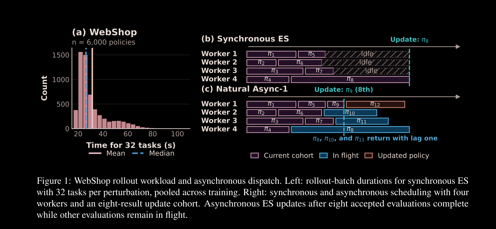
<figcaption aria-hidden="true">Doesn't this look really familiar?</figcaption>
</figure>
</div>
<br>

The figure is from ["Asynchrony Is Nearly Free for Evolution Strategies on Long-Horizon LLM Agentic Tasks"](https://arxiv.org/abs/2610.04196v2), it's a pretty good paper. 

At Prime Intellect we wrote [prime-rl](https://github.com/PrimeIntellect-ai/prime-rl) as the first truly proper runtime for distributed async RL. The architecture is in three parts. The training machines, the workers, and the environments. You send the model to workers, the environment machines use those workers to produce rollouts, and the rollouts are the data that the trainer trains on.

But in zeroth order "RL", you actually don't have to send the logits from the worker machines back to the trainer. Just the scores and seeds. This saves you some bandwidth. That's neat, and potentially useful as batch/group sizes (as in GRPO) grow larger.

Otherwise, the architecture of such a training setup looks eerily similar. It may even be reasonable to support ZO in prime-rl itself.

## Future Directions

It's kinda obvious to me that there's more to be done for reducing bias. I think it would be cool to do experiments training a YOCO model with Dust. I tweeted about it [here](https://x.com/apaz_cli/status/2114251136937193745). It splits it into a dust-optimal part (the cross-decoder) and a dust-hostile part (the self-decoder). There is no leakage in the cross-decoder, it is all moved into the self-decoder. The two could be trained with different hparams or estimators. This seems like an interesting direction.

<br>
<div style="text-align: center;">
<figure>
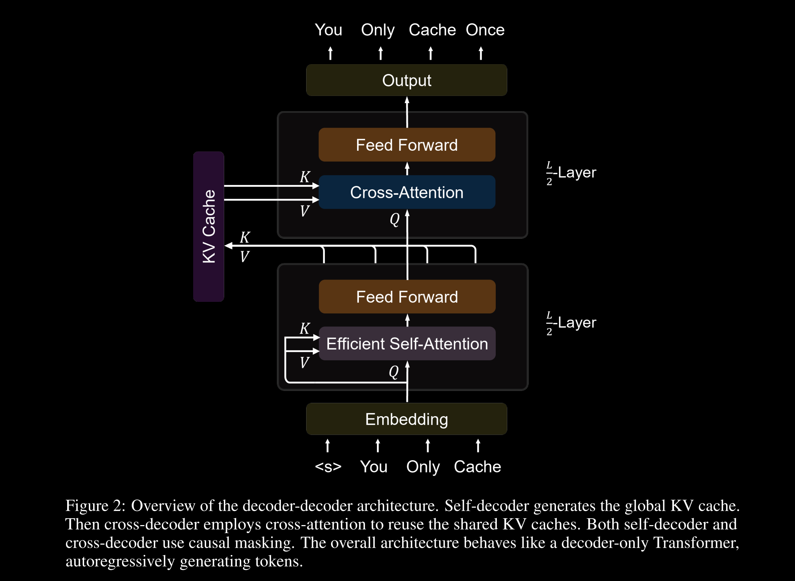
<figcaption aria-hidden="true">An overview of YOCO from a single diagram from [the paper](https://arxiv.org/abs/2405.05254).</figcaption>
</figure>
</div>
<br>

Also, obviously there is some work to be done with seeing how Dust scales to long sequences, different attention mechanisms, etc. I presume qlabs is already doing or has already done that, and so I leave it to them.

I think what we know how to do is something like the following.

#### For Pretraining
* You can use Dust to pretrain a parallelizable arch without recurrence (like a transformer)
* There is no good way to pretrain any other sort of model, since SPSA collapses

Once you add recurrence, replaying the forward pass gets much more expensive. Once you make the forward pass not parallelizable, you miss a multiple of your batch size in the SNR. Traditionally, the appeal of ZO has been that you can do both without losing anything.

#### For RL-style Posttraining
* Or use SPSA or RandOpt or whatever, posttraining just works.

I think Dust gets you basically nothing for posttraining, because the loss function is not separable. Assuming your arch has no recurrence, you can sample output perturbations and get some free SNR. But the gains aren't going to be, like, profound, because it already works pretty well.

With that said it's probably a free paper to anyone who wants it.

As for what I'm going to be doing, I'm going to add a Dust training codebase to ZOTitan. Then maybe look into the YOCO stuff and do some scaling experiments.

In the meantime, if you're interested in this stuff, feel free to hit me up. DM me [@apaz_cli](https://x.com/apaz_cli), I'm trying to start a twitter group chat of Zeroth Order Optimization researchers. I really want to push ZO forward. But that starts with getting everyone in the same room to talk about it, brainstorm ideas, etc. I don't think I can do it alone.


<br>
<div style="text-align: center;">
<figure>
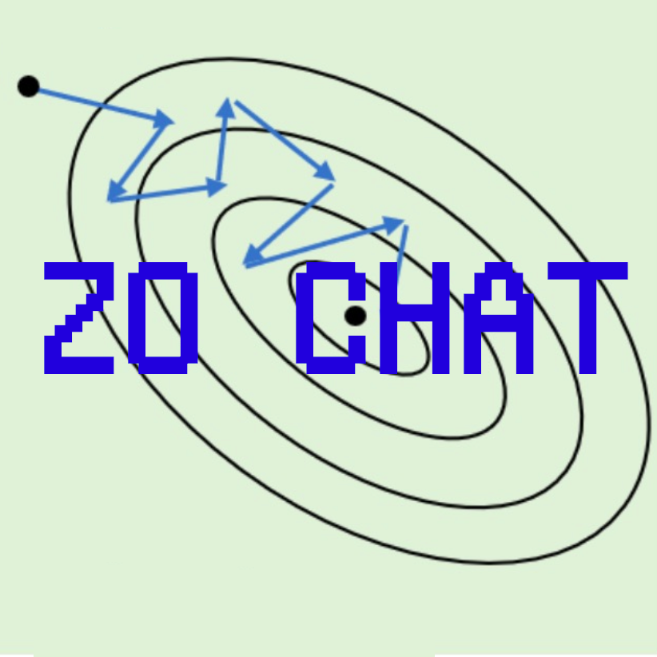
<figcaption aria-hidden="true">ZO Chat beckons you.</figcaption>
</figure>
</div>
<br>

So yeah, there's my brain dump. Until next time, happy hacking.
